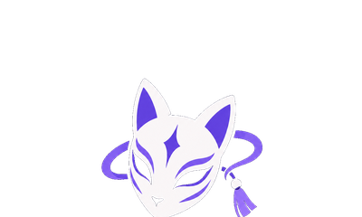

<p align="center">
  
</p>

<h1 align="center">AniMood</h1>

<p align="center">
  <b>Find anime that match your mood.</b><br>
  Moodboard, feed, forum, mini-games, profiles and messages.
</p>

<p align="center">
  <a href="README.md">🇫🇷 Français</a> · 🇬🇧 English
</p>

<p align="center">
  🌐 <a href="https://animood.me"><b>animood.me</b></a> ·
  📲 <a href="https://github.com/casval-bit/animood/releases/latest">Download the app</a> ·
  🐞 <a href="https://github.com/casval-bit/animood/issues">Report a bug</a>
</p>

---

## What is it?

AniMood is a free website (and app) that helps you pick what to watch: choose one or more **moods** (Hype, Chill, Dark…) and AniMood suggests 3 matching anime, with unlimited rerolls. Around it lives a small community: feed, forum, private messages, mini-games and profiles.

The site is available in **French and English**.

## 📱 Where to use it

| Platform | How to get it |
|---|---|
| 🌐 Web | https://animood.me |
| 🤖 Android | APK download on the site |
| 🍏 iPhone / iPad | Safari → Share → "Add to Home Screen" |
| 🪟 Windows · 🍎 Mac · 🐧 Linux | Installers on the site or in the [releases](https://github.com/casval-bit/animood/releases/latest) |

Every app shows the live site, so they're always up to date.

## ✨ Features

**Discover**
- **Moodboard** — pick one or more moods, AniMood suggests 3 anime, reroll as much as you like.
- **Search** — Anime / 📅 Season / Studio / Artist / Members tabs.
- **Season calendar** — Day or Week view in your time zone, platform filters and "My calendar".
- **Recently finished**, **trailers** for upcoming releases, **streaming links** for your region.
- **Anime page** — details, trailer, dedicated discussions, the studio's full catalogue.

**Community**
- **Feed** — posts, comments, likes, polls, `@mentions`.
- **Forum** — tagged threads with images, likes, replies.
- **Private messages** — "Sent ✓ → Delivered ✓✓ → Read" receipts.
- **Notifications**, **blocking** and automatic **moderation**.

**Games**
- **Daily solo** — Anime Wordle, Mystery Poster, OP Quiz.
- **Multiplayer** — Anime Chain, Timeline, Cluescale, Undercover: Elo ranking, private rooms, invites, vs-AI mode.
- **Tierlist** — rank anime from S to F, export as an image.

**Profile**
- Stats, moods, genres, favourites, lists, journal, posts.
- Animated frames, badges and points to unlock.
- Privacy: profile visible to everyone, to friends, or to a chosen list.
- AniList import.

---

## 🛠️ For developers

**Stack:** React + Vite + Tailwind · Supabase (database and accounts) · Electron (desktop app) · Jikan / AniList / AnimeThemes (catalogue) · Tenrai + AniList (sync scripts)

### Run locally

```bash
git clone https://github.com/casval-bit/animood.git
cd animood
npm install
npm run dev
```

Open `http://localhost:5173`. No setup needed: the Supabase key in the code is the **public** key (meant to be visible; the database is protected by its access rules).

| Command | What it does |
|---|---|
| `npm run dev` | Dev server for the site |
| `npm run build` | Build the site |
| `npm run lint` | Lint the code |
| `npm run electron:dev` | Desktop app in dev mode (or `run_desktop.bat`) |
| `npm run electron:fix` | Repairs Electron if it won't start ("failed to install correctly": Electron's installer silently fails on Node 24) — `electron:dev` already does it automatically |

### Repository layout

| Folder | Contents |
|---|---|
| `src/` | The site (React): `views/` pages, `components/` building blocks, `api/` service calls, `constants/` FR/EN texts and settings |
| `public/` | Images, icons, manifest, Android APK |
| `electron/` | Desktop app (Windows / Mac / Linux) |
| `scripts/` + `run_*.bat` | Anime catalogue sync scripts |
| `supabase/` | SQL schemas and database security rules |
| `.github/workflows/` | Automatic syncs and desktop app builds |
| `docs/` | Internal notes (in French): [publishing and maintenance](docs/MAINTENANCE.md), [color palettes](docs/PALETTES.md), Microsoft Store, Moodboard |

The `animood-v.XX` branches are older versions; the current version is on **`main`**.

---

## 🕓 Versions

| Version | What's new |
|---|---|
| **v.14.05** | **Colors on the website and the APK too** (not only the desktop app) and **8 new palettes**: Cyan / turquoise, Pink / magenta, Emerald / green, Gray / silver, then more unexpected blends: **Gold / violet, Blue / orange, Violet / turquoise, Brown / caramel** (12 in total, Settings → Preferences → Colors; the mobile browser bar takes the chosen color). **Readable light theme**: pale texts designed for the dark background are darkened automatically (rules generated in `src/palettes.css`, they follow the palette), darker grays, nearly opaque windows; profile cards (HUD), the desktop header and the anime sheet's poster banner keep their dark background; the dark theme is unchanged. **Search** (desktop app): the main tab keeps "Top rated" and adds **"Most active this week"** (ratings, posts, comments, Forum threads and replies from the last 7 days; blocked members excluded; no SQL to install). **Sync**: AniList and AnimeThemes clients that respect the real API limits (batches of 50 anime, pause after a 429) and a per-step time budget (no more syncs over 2 h); "Write summary" no longer fails the job; table of limits in `docs/MAINTENANCE.md`. **End of year: "AniMood 2026" space** (until 15 January 2027): a "Happy holidays" block under the header (website Forum, desktop Forum and Games; its cross closes it until the next sign-in, it does not come back when the page is reloaded) opens a window with the **community favourite**, a **Top 3** (each member votes: 1st place = 3 points, 2nd = 2, 3rd = 1; community or friends ranking, by points, by number of #1 or by best #1 ratio), a **Tierlist** and a **customizable grid** (best animation, OST, male MC, female MC…; cells can be renamed and added, and the same anime can fill several cells) to **download, copy or share** as an image. Only anime released in 2026 can be picked, any format (series, films, OVA, ONA, donghua, Korean animation…), no ads or clips. A "2026" entry in the desktop Games tab and in the website Forum's mini-games panel. **SQL to run**: `supabase/awards_2026_schema.sql` (votes table; without it the space still opens and the vote stays on the device). **Settings**: same tabs everywhere, notification settings (comments, mentions, game invites) grouped, reliable closing (fallback if "back" does not answer, Esc). **Fixes**: `npm test` also passes on Windows (CRLF line endings, no `bash`); **desktop app: the "←" of Settings and the "Retour" (back) button of the footer pages** (About, FAQ, Contact, Categories & Moods, Moderation, legal notice, privacy) **now answer to the mouse**: the header's "drag the window" zone stayed active under open windows and took the click for the start of a window drag. Every window (anime sheets, game rooms, Settings, pages) now removes that zone under itself; the top bar of full-screen pages still drags the window. Website and APK unchanged; rule for future windows in `docs/MAINTENANCE.md`; **Tierlist: saving as an image now also works in the light theme** (it failed, whatever the palette; the image is always drawn in the dark style, like the card); **the text of exported images (tierlist, grid) is now drawn in the right place** (it came out about 5 px too low, which cut two-line cell names of the grid in half) |
| v.14.04 | "Get the app" page (the website header's **App** button): **real platform logos** (Android, iPhone / iPad, Windows, macOS, Linux) instead of emojis or hand-drawn shapes, readable in dark and light (Tux is dark in light mode); Android robot licence and trademark notice at the bottom. The page (and About, FAQ, Contact…) now has an opaque background: in light mode the site no longer shows through the text and the "Back" bar is readable |
| v.14.03 | Desktop app: **new "Colors" option in Settings → Preferences** to change the colors of the whole app (on top of dark / light): Blue / violet (original), Yellow / orange, Red / salmon, Green / pink. The choice is remembered, applied right at startup, and works in both dark and light (backgrounds, buttons, gradients, glows, games, profile…). White button text stays readable on the lighter hues. The website is not affected: it keeps its colors. Details in `docs/PALETTES.md` |
| v.14.02 | Mini-games reworked for the desktop app: new windows (Friends / Ranked / AI modes, same room with code and invitations for every game), always-visible "Forfeit" button, end screen showing the ELO and points won or lost, fixed Timeline (a missed card is replaced instead of vanishing, winner's points, second player's last chance), more believable AI (3 levels, record kept on the device), Cluescale ties, Tierlist: the saved image finally contains the posters, sync scripts: streaming platforms completed via Tenrai when AniList doesn't know an anime, a refused Tenrai key no longer breaks the sync (it carries on without a key) |
| v.14.01 | More reliable multiplayer mini-games (each seat can be taken only once, no more ghost games, automatic forfeit of an absent opponent, ELO and points applied exactly once, AI games never write to the database, Cluescale without lost votes, reviewed Undercover words/hints), official platform icons on the "App" page, "Other suggestions" button next to "Find my anime", Settings/Messages buttons swapped, `npm test` (game rules), daily cleanup of abandoned rooms, sync scripts moved from Jikan to Tenrai + AniList (streaming in batches of 50, outage breaker, per-step time limits) |
| v.14.00 | Reworked Moodboard (minimum mood threshold, friends' ratings, no more duplicate seasons, animated stage on large web screens too), Tierlist Studio, HUD-style profile, fixed calendar, frameless desktop window, new login page, animood.me domain |
| v.13.00 | Stronger security (database, desktop app, site headers), QR-code install, mobile tab bar |
| v.12.00 | Site goes live, Android / Windows / Mac / Linux apps, download page, Google sign-in on the desktop app |
| v.11.02 | Desktop app, richer profile, streaming by region |
| v.11.01 | Trailer button, footer logos, forum tabs |
| v.11.00 | Undercover, Tierlist, calendar filters, recently finished, animated frames |
| v.10.02 | 3-step read receipts, new logo, Day/Week calendar |
| v.10.00 | Game invites, Elo ranking, profile privacy, footer |

---

## 📬 Contact

- Bug or idea: [open an issue](https://github.com/casval-bit/animood/issues)
- Email: animood.officiel@gmail.com

<sub>Anime data comes from MyAnimeList (via Jikan), AniList and AnimeThemes. AniMood is not affiliated with any of these services.</sub>
