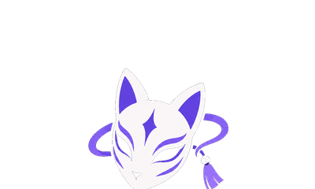

<p align="center">
  
</p>

<h1 align="center">AniMood</h1>

<p align="center">
  <b>Find anime that match your mood.</b><br>
  Moodboard, feed, forum, mini-games, profiles and messages.
</p>

<p align="center">
  <a href="README.md">🇫🇷 Français</a> · 🇬🇧 English
</p>

<p align="center">
  🌐 <a href="https://animood.me"><b>animood.me</b></a> ·
  📲 <a href="https://github.com/casval-bit/animood/releases/latest">Download the app</a> ·
  🐞 <a href="https://github.com/casval-bit/animood/issues">Report a bug</a>
</p>

---

## What is it?

AniMood is a free website (and app) that helps you pick what to watch: choose one or more **moods** (Hype, Chill, Dark…) and AniMood suggests 3 matching anime, with unlimited rerolls. Around it lives a small community: feed, forum, private messages, mini-games and profiles.

The site is available in **French and English**.

## 📱 Where to use it

| Platform | How to get it |
|---|---|
| 🌐 Web | https://animood.me |
| 🤖 Android | APK download on the site |
| 🍏 iPhone / iPad | Safari → Share → "Add to Home Screen" |
| 🪟 Windows · 🍎 Mac · 🐧 Linux | Installers on the site or in the [releases](https://github.com/casval-bit/animood/releases/latest) |

Every app shows the live site, so they're always up to date.

## ✨ Features

**Discover**
- **Moodboard** — pick one or more moods, AniMood suggests 3 anime, reroll as much as you like.
- **Search** — Anime / 📅 Season / Studio / Artist / Members tabs.
- **Season calendar** — Day or Week view in your time zone, platform filters and "My calendar".
- **Recently finished**, **trailers** for upcoming releases, **streaming links** for your region.
- **Anime page** — details, trailer, dedicated discussions, the studio's full catalogue.

**Community**
- **Feed** — posts, comments, likes, polls, `@mentions`.
- **Forum** — tagged threads with images, likes, replies.
- **Private messages** — "Sent ✓ → Delivered ✓✓ → Read" receipts.
- **Notifications**, **blocking** and automatic **moderation**.

**Games**
- **Daily solo** — Anime Wordle, Mystery Poster, OP Quiz.
- **Multiplayer** — Anime Chain, Timeline, Cluescale, Undercover: Elo ranking, private rooms, invites, vs-AI mode.
- **Tierlist** — rank anime from S to F, export as an image.

**Profile**
- Stats, moods, genres, favourites, lists, journal, posts.
- Animated frames, badges and points to unlock.
- Privacy: profile visible to everyone, to friends, or to a chosen list.
- AniList import.

---

## 🛠️ For developers

**Stack:** React + Vite + Tailwind · Supabase (database and accounts) · Electron (desktop app) · Jikan / AniList / AnimeThemes (catalogue)

### Run locally

```bash
git clone https://github.com/casval-bit/animood.git
cd animood
npm install
npm run dev
```

Open `http://localhost:5173`. No setup needed: the Supabase key in the code is the **public** key (meant to be visible; the database is protected by its access rules).

| Command | What it does |
|---|---|
| `npm run dev` | Dev server for the site |
| `npm run build` | Build the site |
| `npm run lint` | Lint the code |
| `npm run electron:dev` | Desktop app in dev mode (or `run_desktop.bat`) |

### Repository layout

| Folder | Contents |
|---|---|
| `src/` | The site (React): `views/` pages, `components/` building blocks, `api/` service calls, `constants/` FR/EN texts and settings |
| `public/` | Images, icons, manifest, Android APK |
| `electron/` | Desktop app (Windows / Mac / Linux) |
| `scripts/` + `run_*.bat` | Anime catalogue sync scripts |
| `supabase/` | SQL schemas and database security rules |
| `.github/workflows/` | Automatic syncs and desktop app builds |
| `docs/` | Internal notes (in French): [publishing and maintenance](docs/MAINTENANCE.md), Microsoft Store, Moodboard |

The `animood-v.XX` branches are older versions; the current version is on **`main`**.

---

## 🕓 Versions

| Version | What's new |
|---|---|
| **v.14.01** | More reliable multiplayer mini-games (each seat can be taken only once, no more ghost games, automatic forfeit of an absent opponent, ELO and points applied exactly once, AI games never write to the database, Cluescale without lost votes, reviewed Undercover words/hints), official platform icons on the "App" page, "Other suggestions" button next to "Find my anime", Settings/Messages buttons swapped, `npm test` (game rules), daily cleanup of abandoned rooms |
| v.14.00 | Reworked Moodboard (minimum mood threshold, friends' ratings, no more duplicate seasons, animated stage on large web screens too), Tierlist Studio, HUD-style profile, fixed calendar, frameless desktop window, new login page, animood.me domain |
| v.13.00 | Stronger security (database, desktop app, site headers), QR-code install, mobile tab bar |
| v.12.00 | Site goes live, Android / Windows / Mac / Linux apps, download page, Google sign-in on the desktop app |
| v.11.02 | Desktop app, richer profile, streaming by region |
| v.11.01 | Trailer button, footer logos, forum tabs |
| v.11.00 | Undercover, Tierlist, calendar filters, recently finished, animated frames |
| v.10.02 | 3-step read receipts, new logo, Day/Week calendar |
| v.10.00 | Game invites, Elo ranking, profile privacy, footer |

---

## 📬 Contact

- Bug or idea: [open an issue](https://github.com/casval-bit/animood/issues)
- Email: animood.officiel@gmail.com

<sub>Anime data comes from MyAnimeList (via Jikan), AniList and AnimeThemes. AniMood is not affiliated with any of these services.</sub>
