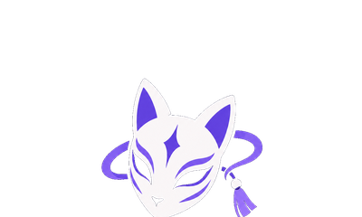

<p align="center">
  
</p>

<h1 align="center">AniMood</h1>

<p align="center">
  <b>Découvre des animés selon ton humeur.</b><br>
  Moodboard, feed, forum, mini-jeux, profils et messages.
</p>

<p align="center">
  🇫🇷 Français · <a href="README.en.md">🇬🇧 English</a>
</p>

<p align="center">
  🌐 <a href="https://animood.me"><b>animood.me</b></a> ·
  📲 <a href="https://github.com/casval-bit/animood/releases/latest">Télécharger l'appli</a> ·
  🐞 <a href="https://github.com/casval-bit/animood/issues">Signaler un bug</a>
</p>

---

## C'est quoi ?

AniMood est un site (et une appli) gratuit pour trouver quoi regarder : tu choisis une ou plusieurs **humeurs** (Hype, Chill, Dark…) et AniMood te propose 3 animés qui collent, avec un reroll à volonté. Autour, il y a une petite communauté : feed, forum, messages privés, mini-jeux et profils.

Le site est disponible en **français et en anglais**.

## 📱 Où l'utiliser

| Plateforme | Comment l'avoir |
|---|---|
| 🌐 Web | https://animood.me |
| 🤖 Android | APK à télécharger sur le site |
| 🍏 iPhone / iPad | Safari → Partager → « Sur l'écran d'accueil » |
| 🪟 Windows · 🍎 Mac · 🐧 Linux | Installateurs sur le site ou dans les [releases](https://github.com/casval-bit/animood/releases/latest) |

Toutes les applis affichent le site en ligne : elles sont toujours à jour.

## ✨ Fonctionnalités

**Découvrir**
- **Moodboard** — choisis une ou plusieurs humeurs, AniMood propose 3 animés, reroll à volonté.
- **Recherche** — onglets Animé / 📅 Saison / Studio / Artiste / Membres.
- **Calendrier de la saison** — vue Jour ou Semaine, à ton heure, filtres plateforme et « Mon calendrier ».
- **Terminés récemment**, **trailers** des prochaines sorties, **liens streaming** selon ta région.
- **Fiche animé** — infos, trailer, discussions dédiées, catalogue complet du studio.

**Communauté**
- **Feed** — posts, commentaires, likes, sondages, `@mentions`.
- **Forum** — sujets tagués avec image, likes, réponses.
- **Messages privés** — accusés « Envoyé ✓ → Vu ✓✓ → Lu ».
- **Notifications**, **blocage** et **modération** automatique.

**Jeux**
- **Solo du jour** — Wordle Animé, Poster Mystère, OP Quiz.
- **Multijoueur** — Chaîne Animé, Timeline, Cluescale, Undercover : classement Elo, rooms privées, invitations, mode vs IA.
- **Tierlist** — classe les animés de S à F, export en image.

**Profil**
- Stats, moods, genres, favoris, listes, journal, posts.
- Cadres animés, badges et points à débloquer.
- Confidentialité : profil visible par tous, par les amis ou par une liste choisie.
- Import depuis AniList.

---

## 🛠️ Pour les développeurs

**Technos :** React + Vite + Tailwind · Supabase (base de données et comptes) · Electron (appli de bureau) · Jikan / AniList / AnimeThemes (catalogue) · Tenrai + AniList (scripts de synchro)

### Lancer en local

```bash
git clone https://github.com/casval-bit/animood.git
cd animood
npm install
npm run dev
```

Ouvre `http://localhost:5173`. Aucune config nécessaire : la clé Supabase présente dans le code est la clé **publique** (prévue pour être visible, la base est protégée par ses règles d'accès).

| Commande | Rôle |
|---|---|
| `npm run dev` | Site en mode dev |
| `npm run build` | Build du site |
| `npm run lint` | Vérifie le code |
| `npm run electron:dev` | Appli de bureau en mode dev (ou `run_desktop.bat`) |
| `npm run electron:fix` | Répare Electron s'il ne démarre pas (« failed to install correctly », bug de son installateur avec Node 24) — `electron:dev` le fait déjà tout seul |

### Organisation du dépôt

| Dossier | Contenu |
|---|---|
| `src/` | Le site (React) : `views/` les pages, `components/` les blocs, `api/` les appels aux services, `constants/` textes FR/EN et réglages |
| `public/` | Images, icônes, manifest, APK Android |
| `electron/` | L'appli de bureau (Windows / Mac / Linux) |
| `scripts/` + `run_*.bat` | Scripts de synchronisation du catalogue d'animés |
| `supabase/` | Schémas SQL et règles de sécurité de la base |
| `.github/workflows/` | Synchros automatiques et compilation de l'appli de bureau |
| `docs/` | Notes internes : [publication et maintenance](docs/MAINTENANCE.md), [palettes de couleurs](docs/PALETTES.md), Microsoft Store, Moodboard |

Les branches `animood-v.XX` sont les anciennes versions ; la version actuelle est sur **`main`**.

---

## 🕓 Versions

| Version | Nouveautés |
|---|---|
| **v.14.05** | **Couleurs aussi sur le site et l'APK** (plus seulement l'appli de bureau) et **8 nouvelles palettes** : Cyan / turquoise, Rose / magenta, Émeraude / vert, Gris / argent, puis des mélanges plus inattendus : **Or / violet, Bleu / orange, Violet / turquoise, Marron / caramel** (12 au total, Paramètres → Préférences → Couleurs ; la barre du navigateur mobile prend la couleur choisie). **Thème clair lisible** : les textes pâles pensés pour le fond sombre sont assombris automatiquement (règles générées dans `src/palettes.css`, elles suivent la palette), gris plus foncés, fenêtres presque opaques ; les cartes du profil (HUD), l'en-tête du bureau et le bandeau d'affiche de la fiche animé gardent leur fond sombre ; le thème sombre ne change pas. **Recherche** (appli de bureau) : l'onglet principal garde « Les mieux notés » et ajoute **« Les plus actifs cette semaine »** (notes, posts, commentaires, sujets et réponses du Forum des 7 derniers jours ; membres bloqués exclus ; aucun SQL à installer). **Synchro** : clients AniList et AnimeThemes qui respectent les limites réelles des API (paquets de 50 animés, pause après un 429) et budget de temps par étape (fini les synchros de plus de 2 h) ; « Write summary » ne fait plus échouer le job ; tableau des limites dans `docs/MAINTENANCE.md`. **Fin d'année : espace « AniMood 2026 »** (jusqu'au 15 janvier 2027) : un bloc « Bonnes fêtes de fin d'année » sous l'en-tête (Forum du site, Forum et Jeux de l'appli de bureau ; sa croix le ferme jusqu'à la prochaine connexion, il ne revient pas quand on recharge la page) montre le **podium de la communauté** (les 3 animés en tête au total des points, avec leurs affiches ; il se met à jour tout seul : toutes les 90 s, au retour sur la page et dès qu'on vote) et ouvre une fenêtre festive (cadre doré, en-tête « AniMood 2026 », trois gros onglets Top 3 / Tierlist / Grille) avec le **favori de la communauté**, un **Top 3** (chaque membre vote : 1ʳᵉ place = 3 points, 2ᵉ = 2, 3ᵉ = 1 ; classement de la communauté ou des amis, en points, en nombre de n°1 ou en meilleur ratio de n°1), une **Tierlist** et une **grille personnalisable** (meilleure animation, OST, perso masculin, perso féminin… ; cases à renommer, à ajouter, et le même animé peut remplir plusieurs cases) à **télécharger, copier ou partager** en image. On ne choisit que des animés sortis en 2026, tous formats (séries, films, OVA, ONA, donghua, animation coréenne…), sans publicités ni clips. Entrée « 2026 » dans l'onglet Jeux du bureau et dans le panneau des mini-jeux du Forum du site. **SQL à lancer** : `supabase/awards_2026_schema.sql` (table des votes ; sans elle l'espace s'ouvre quand même et le vote reste sur l'appareil). **Paramètres** : mêmes onglets partout, réglages de notifications (commentaires, mentions, invitations de jeu) regroupés, fermeture fiable (secours si « retour » ne répond pas, Échap). **Correctifs** : `npm test` passe aussi sous Windows (fins de ligne CRLF, `bash` absent) ; **appli de bureau : le « ← » des Paramètres et le « Retour » des pages du pied de page** (À propos, FAQ, Contact, Catégories & Moods, Modération, mentions légales, confidentialité) **répondent enfin à la souris** : la zone « déplacer la fenêtre » de l'en-tête restait active sous les fenêtres ouvertes et prenait le clic pour un début de déplacement. Chaque fenêtre (fiches animé, salons de jeu, Paramètres, pages) retire maintenant cette zone sous elle ; la barre du haut des pages plein écran sert toujours à déplacer la fenêtre. Site web et APK inchangés ; règle pour les futures fenêtres dans `docs/MAINTENANCE.md` ; **Tierlist : l'enregistrement en image marche aussi en thème clair** (il échouait, quelle que soit la palette ; l'image est toujours dessinée en style sombre, comme la carte) ; **le texte des images (tierlist, grille) est dessiné à sa place** (il sortait environ 5 px trop bas : les noms de cases de la grille sur deux lignes étaient coupés) |
| v.14.04 | Page « Télécharger l'appli » (bouton **Appli** du header du site) : **vrais logos des plateformes** (Android, iPhone / iPad, Windows, macOS, Linux) à la place des emojis ou des dessins maison, lisibles en thème sombre comme clair (Tux foncé en clair) ; mention de la licence du robot Android et des marques en bas de page. La page (et À propos, FAQ, Contact…) a maintenant un fond opaque : en thème clair, le site ne transparaît plus derrière le texte et la barre « Retour » est lisible |
| v.14.03 | Appli de bureau : **nouvelle option « Couleurs » dans Paramètres → Préférences** pour changer les couleurs de toute l'appli (en plus du thème sombre / clair) : Bleu / violet (d'origine), Jaune / orange, Rouge / saumon, Vert / rose. Le choix est mémorisé, appliqué dès l'ouverture, et fonctionne en sombre comme en clair (fonds, boutons, dégradés, lueurs, jeux, profil…). Le texte blanc des boutons reste lisible sur les teintes claires. Le site web n'est pas concerné : il garde ses couleurs. Détails dans `docs/PALETTES.md` |
| v.14.02 | Mini-jeux repensés pour l'appli de bureau : nouvelles fenêtres (modes Entre amis / Classé / IA, salon avec code et invitations identiques pour tous les jeux), bouton « Abandonner » toujours visible, écran de fin avec ELO et points gagnés ou perdus, Timeline corrigée (une carte ratée est remplacée au lieu de disparaître, points du gagnant, dernière chance du 2ᵉ joueur), IA plus crédible (3 niveaux, bilan gardé sur l'appareil), égalité de Cluescale, Tierlist : l'image enregistrée contient enfin les affiches, scripts de synchro : plateformes de streaming complétées via Tenrai quand AniList ne connaît pas un animé, clé Tenrai refusée = la synchro continue sans clé |
| v.14.01 | Mini-jeux multijoueur fiabilisés (une seule salle prise par place, plus de parties fantômes, abandon automatique d'un adversaire absent, ELO et points appliqués une seule fois, IA sans écriture en base, Cluescale sans vote perdu, mots/indices de l'Imposteur revus), icônes officielles dans la page « Appli », bouton « Autres suggestions » à côté de « Trouver mon anime », boutons Paramètres/Messagerie inversés, `npm test` (règles de jeu), ménage quotidien des salles abandonnées, scripts de synchro passés de Jikan à Tenrai + AniList (streaming par lots de 50, disjoncteur anti-panne, limites de temps par étape) |
| v.14.00 | Moodboard refondu (palier de mood minimum, notes des amis, plus de doublon de saison, scène animée aussi sur grand écran web), Tierlist Studio, profil au style HUD, calendrier corrigé, fenêtre de bureau sans cadre, nouvelle page de connexion, nom de domaine animood.me |
| v.13.00 | Sécurité renforcée (base de données, appli de bureau, en-têtes du site), installation par QR code, barre d'onglets mobile |
| v.12.00 | Site en ligne, applis Android / Windows / Mac / Linux, page de téléchargement, connexion Google sur l'appli de bureau |
| v.11.02 | Appli de bureau, profil enrichi, streaming par région |
| v.11.01 | Bouton trailer, logos footer, onglets forum |
| v.11.00 | Undercover, Tierlist, filtres calendrier, terminés récemment, cadres animés |
| v.10.02 | Accusés de réception en 3 étapes, nouveau logo, calendrier Jour/Semaine |
| v.10.00 | Invitations de jeu, classement Elo, confidentialité du profil, footer |

---

## 📬 Contact

- Bug ou idée : [ouvre une issue](https://github.com/casval-bit/animood/issues)
- E-mail : animood.officiel@gmail.com

<sub>Les données sur les animés viennent de MyAnimeList (via Jikan), AniList et AnimeThemes. AniMood n'est affilié à aucun de ces services.</sub>
