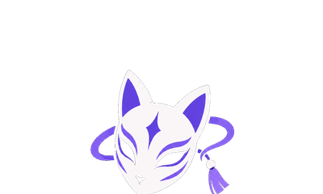

<p align="center">
  
</p>

<h1 align="center">AniMood</h1>

<p align="center">
  <b>Découvre des animés selon ton humeur.</b><br>
  Moodboard, feed, forum, mini-jeux, profils et messages.
</p>

<p align="center">
  🇫🇷 Français · <a href="README.en.md">🇬🇧 English</a>
</p>

<p align="center">
  🌐 <a href="https://animood.me"><b>animood.me</b></a> ·
  📲 <a href="https://github.com/casval-bit/animood/releases/latest">Télécharger l'appli</a> ·
  🐞 <a href="https://github.com/casval-bit/animood/issues">Signaler un bug</a>
</p>

---

## C'est quoi ?

AniMood est un site (et une appli) gratuit pour trouver quoi regarder : tu choisis une ou plusieurs **humeurs** (Hype, Chill, Dark…) et AniMood te propose 3 animés qui collent, avec un reroll à volonté. Autour, il y a une petite communauté : feed, forum, messages privés, mini-jeux et profils.

Le site est disponible en **français et en anglais**.

## 📱 Où l'utiliser

| Plateforme | Comment l'avoir |
|---|---|
| 🌐 Web | https://animood.me |
| 🤖 Android | APK à télécharger sur le site |
| 🍏 iPhone / iPad | Safari → Partager → « Sur l'écran d'accueil » |
| 🪟 Windows · 🍎 Mac · 🐧 Linux | Installateurs sur le site ou dans les [releases](https://github.com/casval-bit/animood/releases/latest) |

Toutes les applis affichent le site en ligne : elles sont toujours à jour.

## ✨ Fonctionnalités

**Découvrir**
- **Moodboard** — choisis une ou plusieurs humeurs, AniMood propose 3 animés, reroll à volonté.
- **Recherche** — onglets Animé / 📅 Saison / Studio / Artiste / Membres.
- **Calendrier de la saison** — vue Jour ou Semaine, à ton heure, filtres plateforme et « Mon calendrier ».
- **Terminés récemment**, **trailers** des prochaines sorties, **liens streaming** selon ta région.
- **Fiche animé** — infos, trailer, discussions dédiées, catalogue complet du studio.

**Communauté**
- **Feed** — posts, commentaires, likes, sondages, `@mentions`.
- **Forum** — sujets tagués avec image, likes, réponses.
- **Messages privés** — accusés « Envoyé ✓ → Vu ✓✓ → Lu ».
- **Notifications**, **blocage** et **modération** automatique.

**Jeux**
- **Solo du jour** — Wordle Animé, Poster Mystère, OP Quiz.
- **Multijoueur** — Chaîne Animé, Timeline, Cluescale, Undercover : classement Elo, rooms privées, invitations, mode vs IA.
- **Tierlist** — classe les animés de S à F, export en image.

**Profil**
- Stats, moods, genres, favoris, listes, journal, posts.
- Cadres animés, badges et points à débloquer.
- Confidentialité : profil visible par tous, par les amis ou par une liste choisie.
- Import depuis AniList.

---

## 🛠️ Pour les développeurs

**Technos :** React + Vite + Tailwind · Supabase (base de données et comptes) · Electron (appli de bureau) · Jikan / AniList / AnimeThemes (catalogue) · Tenrai + AniList (scripts de synchro)

### Lancer en local

```bash
git clone https://github.com/casval-bit/animood.git
cd animood
npm install
npm run dev
```

Ouvre `http://localhost:5173`. Aucune config nécessaire : la clé Supabase présente dans le code est la clé **publique** (prévue pour être visible, la base est protégée par ses règles d'accès).

| Commande | Rôle |
|---|---|
| `npm run dev` | Site en mode dev |
| `npm run build` | Build du site |
| `npm run lint` | Vérifie le code |
| `npm run electron:dev` | Appli de bureau en mode dev (ou `run_desktop.bat`) |
| `npm run electron:fix` | Répare Electron s'il ne démarre pas (« failed to install correctly », bug de son installateur avec Node 24) — `electron:dev` le fait déjà tout seul |

### Organisation du dépôt

| Dossier | Contenu |
|---|---|
| `src/` | Le site (React) : `views/` les pages, `components/` les blocs, `api/` les appels aux services, `constants/` textes FR/EN et réglages |
| `public/` | Images, icônes, manifest, APK Android |
| `electron/` | L'appli de bureau (Windows / Mac / Linux) |
| `scripts/` + `run_*.bat` | Scripts de synchronisation du catalogue d'animés |
| `supabase/` | Schémas SQL et règles de sécurité de la base |
| `.github/workflows/` | Synchros automatiques et compilation de l'appli de bureau |
| `docs/` | Notes internes : [publication et maintenance](docs/MAINTENANCE.md), Microsoft Store, Moodboard |

Les branches `animood-v.XX` sont les anciennes versions ; la version actuelle est sur **`main`**.

---

## 🕓 Versions

| Version | Nouveautés |
|---|---|
| **v.14.01** | Mini-jeux multijoueur fiabilisés (une seule salle prise par place, plus de parties fantômes, abandon automatique d'un adversaire absent, ELO et points appliqués une seule fois, IA sans écriture en base, Cluescale sans vote perdu, mots/indices de l'Imposteur revus), icônes officielles dans la page « Appli », bouton « Autres suggestions » à côté de « Trouver mon anime », boutons Paramètres/Messagerie inversés, `npm test` (règles de jeu), ménage quotidien des salles abandonnées, scripts de synchro passés de Jikan à Tenrai + AniList (streaming par lots de 50, disjoncteur anti-panne, limites de temps par étape) |
| v.14.00 | Moodboard refondu (palier de mood minimum, notes des amis, plus de doublon de saison, scène animée aussi sur grand écran web), Tierlist Studio, profil au style HUD, calendrier corrigé, fenêtre de bureau sans cadre, nouvelle page de connexion, nom de domaine animood.me |
| v.13.00 | Sécurité renforcée (base de données, appli de bureau, en-têtes du site), installation par QR code, barre d'onglets mobile |
| v.12.00 | Site en ligne, applis Android / Windows / Mac / Linux, page de téléchargement, connexion Google sur l'appli de bureau |
| v.11.02 | Appli de bureau, profil enrichi, streaming par région |
| v.11.01 | Bouton trailer, logos footer, onglets forum |
| v.11.00 | Undercover, Tierlist, filtres calendrier, terminés récemment, cadres animés |
| v.10.02 | Accusés de réception en 3 étapes, nouveau logo, calendrier Jour/Semaine |
| v.10.00 | Invitations de jeu, classement Elo, confidentialité du profil, footer |

---

## 📬 Contact

- Bug ou idée : [ouvre une issue](https://github.com/casval-bit/animood/issues)
- E-mail : animood.officiel@gmail.com

<sub>Les données sur les animés viennent de MyAnimeList (via Jikan), AniList et AnimeThemes. AniMood n'est affilié à aucun de ces services.</sub>
